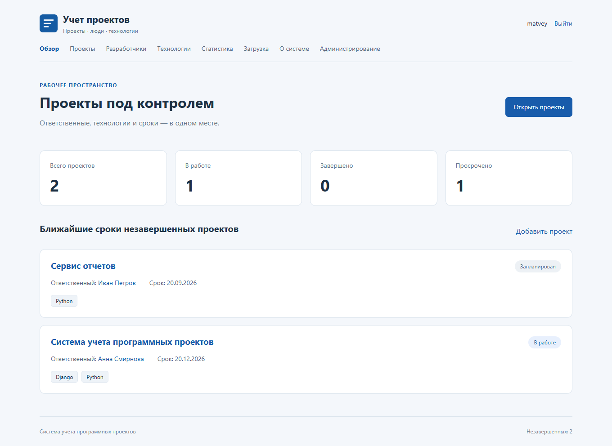

# Система учета программных проектов

Учебное веб-приложение для учета программных проектов. Оно хранит название проекта,
ответственного разработчика, технологии, срок завершения и статус. Поиск и фильтры
помогают найти запись, а статистика показывает ход работ и просроченные проекты.

Студент: Семин Матвей Романович. Группа: ЭФБО-10-24. Преподаватель: Ящун Т. В.

Репозиторий: [MatuhaBtww/TRPBF_p1-3](https://github.com/MatuhaBtww/TRPBF_p1-3).



## Открытие и запуск на этом компьютере

Папка проекта: `C:\Users\Матвей\Documents\project_tracker`.
Исходная папка `проект_фреймворки_ПР3` сохранена отдельно.

Самый простой запуск:

1. Откройте Проводник и перейдите в папку проекта.
2. Дважды нажмите `run.bat`. Оставьте открывшееся окно работающим.
3. Откройте в браузере [главную страницу](http://127.0.0.1:8000/).
4. Для остановки нажмите **Ctrl+C** в окне сервера и подтвердите остановку, если Windows спросит.

Если впервые запускаете скачанную копию, сначала установите Python 3.10 или новее
(на этом компьютере проверен Python 3.14.3). Затем откройте PowerShell и выполните:

```powershell
Set-Location -LiteralPath 'C:\Users\Матвей\Documents\project_tracker'
powershell -NoProfile -ExecutionPolicy Bypass -File .\setup.ps1
.\run.bat
```

`setup.ps1` создает `.venv`, устанавливает зависимости, применяет миграции,
переносит исходные данные в пустую базу и создает локальные учетные записи.
Повторный запуск сохраняет существующие записи и пароли. При установке зависимостей нужен интернет.

## Вход в систему

На главной странице нажмите **Войти**. Данные входа находятся в файле
`.private\admin-access.txt` внутри папки проекта. Откройте его Блокнотом.

- `matvey` — постоянный локальный администратор: создание, изменение и удаление данных.
- `observer` — сотрудник группы «Наблюдатели»: просмотр без изменения записей.
- Без входа доступны списки, карточки, статистика и выгрузка CSV.

Пароли создаются отдельно для каждой установки. Они не входят в Git и общий архив.
Для смены пароля администратора выполните в папке проекта:

```powershell
.\.venv\Scripts\python.exe manage.py changepassword matvey
```

## Как пользоваться

### Создать проект

1. Войдите как администратор.
2. Откройте **Разработчики → Добавить разработчика** и введите ФИО.
3. Откройте **Технологии → Добавить технологию** и введите название.
4. Откройте **Проекты → Добавить проект**.
5. Введите название, выберите ответственного, отметьте хотя бы одну технологию и укажите срок.
6. Нажмите **Сохранить**. Откроется карточка созданного проекта.

Проект начинается со статуса «Запланирован». Когда работы начались, нажмите
**Изменить** в карточке и выберите «В работе». Из работы проект можно вернуть
в план или завершить. Из завершенного статуса обратных переходов нет.
Если форма содержит ошибку, объяснение появится под полем, а введенные значения сохранятся.

### Найти и показать проекты

На странице **Проекты** доступны поиск по названию проекта, разработчику и технологии,
фильтры по статусу, сроку, разработчику и технологии, сортировка по названию, сроку
или разработчику. Нажмите **Применить**, чтобы обновить список, или **Сбросить**,
чтобы убрать условия.

Можно выбрать карточки или таблицу. Ссылка **Скачать CSV** выгружает тот же
отфильтрованный список; CSV открывается в Excel. При большом количестве записей
используйте **Назад / Далее** внизу. Условия поиска при этом сохраняются.

### Изменение и удаление

Нажмите название проекта, затем **Изменить**. Удаление выполняется отдельной
кнопкой с подтверждением. Простое открытие страницы удаления данные не изменяет.
Разработчиков и технологии можно изменять в соответствующих разделах.
Нельзя удалить ответственного, пока он назначен на проект, или оставить проект без технологий.

### Статистика и загрузка

**Обзор** показывает сводку и ближайшие сроки незавершенных проектов.
**Статистика** содержит количество проектов по статусам, разработчикам и технологиям,
а также первый и последний сроки. Просрочка — незавершенный проект со сроком раньше сегодняшней даты.

**Загрузка** показывает разработчиков без незавершенных проектов со сроком до выбранной
даты включительно. Дат начала и трудозатрат в модели нет, поэтому показатель описывает
задолженность по срокам, а не свободные часы в календаре.

### Административная панель

После входа откройте **Администрирование** или [Django Admin](http://127.0.0.1:8000/admin/).
В списке проектов работают поиск, фильтры, навигация по датам, изменение срока прямо
в строке и массовые действия. Для массового изменения отметьте проекты, выберите
действие и нажмите **Выполнить**. Разрешенные изменения сохранятся; количество
пропущенных из-за правил перехода записей будет показано сообщением.

В карточке разработчика отображаются его проекты. В карточке проекта доступны
постоянный адрес и ссылка **Посмотреть на сайте**. Справочник статусов фиксирован.

## Как открыть код в VS Code

1. Запустите VS Code.
2. Выберите **Файл → Открыть папку** и укажите `C:\Users\Матвей\Documents\project_tracker`.
3. Слева в Проводнике выберите `README.md`. Для просмотра оформления нажмите **Ctrl+Shift+V**.
4. Нажмите **Ctrl+Shift+P**, введите `Python: Select Interpreter` и выберите `.venv\Scripts\python.exe`.
5. Выберите **Терминал → Создать терминал**. Команды ниже выполняйте в папке проекта.
6. Для отладки откройте **Запуск и отладка**, выберите конфигурацию **Django** и нажмите **F5**.

Настройки выбора окружения, pytest и отладки сохранены в `.vscode/`.
Расширения Python, Pylance, Python Debugger и SQLite используются для работы с проектом.

## Проверки

```powershell
Set-Location -LiteralPath 'C:\Users\Матвей\Documents\project_tracker'
.\.venv\Scripts\python.exe manage.py check
.\.venv\Scripts\python.exe manage.py makemigrations --check --dry-run
.\.venv\Scripts\python.exe -m pytest -v
.\.venv\Scripts\python.exe -m flake8 .
```

`PASSED` означает успешную проверку конкретного сценария. `FAILED` — несовпадение
с ожидаемым поведением, `ERROR` — ошибку выполнения или подготовки теста.
`check` проверяет настройки; `makemigrations --check` ищет несохраненные изменения моделей.
Тесты работают в отдельной временной базе, а не в рабочей базе приложения.
Текущий протокол и число тестов записаны в `verification.txt`.
Для строк SQL и шаблонных строк в Python в flake8 отключена только проверка длины E501;
исключения E203 и W503 согласованы с форматированием Black.

Для анализа SQL на работающих страницах:

```powershell
.\run.bat debug
```

Откройте боковую панель Debug Toolbar → **SQL**. В обычном запуске панель скрыта.
Тест `test_eager_loading_reduces_queries` сравнивает ленивую и совместную загрузку связей.

## Устройство проекта

| Файл или папка | Назначение |
|---|---|
| `manage.py` | Команды Django, запуск сервера, миграции |
| `config/settings.py`, `config/urls.py` | Настройки и корневые маршруты |
| `tracker/models.py` | Модели, связи, статусы, проверка переходов |
| `tracker/views.py`, `tracker/queries.py` | Обработка запросов и ORM-выборки |
| `tracker/forms.py`, `tracker/admin.py` | Формы и административная панель |
| `tracker/migrations/` | Схема базы и преобразования существующих данных |
| `templates/`, `static/` | HTML, CSS, JavaScript и логотип |
| `data/seed.json` | Исходные данные ПР3 |
| `data/projects.sqlite3` | Текущая рабочая база; в Git не отправляется |
| `db/`, `sql/` | Учебный слой SQLite ПР7 и 12 SQL-запросов |
| `main.py`, `models.py`, `service.py` | Сохраненное консольное приложение ПР3 |
| `tests/` | Исходные тесты и проверки Django, SQL, прав и миграций |
| `reports/` | Отчеты Word |
| `REQUIREMENTS.md`, `DEMO.md` | Соответствие заданиям и порядок защиты |

Проект имеет одного ответственного разработчика и один статус. Связь с технологиями —
«многие ко многим». Статус — самостоятельный справочник; его коды заданы через TextChoices.
`is_completed` вычисляется SQLite через GeneratedField. URL карточки использует уникальный slug.

При изменении статуса из Python используйте `change_status()` или `save()` с проверкой модели.
Массовый `QuerySet.update()` обходит Python-валидацию и не применяется к статусам в интерфейсах.

## Данные и резервные копии

Рабочие данные сохраняются между запусками в SQLite. Не удаляйте `data/` и `.private/`.
Перед переносом на другой компьютер остановите сервер и скопируйте эти папки в личную резервную копию.

Консольная версия запускается командой `.\.venv\Scripts\python.exe main.py` и использует
`data/runtime.json`, а при первом запуске — `data/seed.json`. Веб-часть работает с SQLite.
Для получения совместимого с ПР3 JSON из текущего веб-приложения:

```powershell
.\.venv\Scripts\python.exe manage.py export_json --output data\web-export.json
```

Существующий файл экспорт не перезаписывает. Обратный перенос в **пустую** предметную базу:
`python manage.py import_json --source data\web-export.json`. Импорт сохраняет ID и связи,
а в непустую предметную базу отменяется. Автоматической синхронизации двух хранилищ нет.

## SQL и этапы разработки

Для отдельной учебной базы ПР7:

```powershell
.\.venv\Scripts\python.exe -m db.import_json
.\.venv\Scripts\python.exe -m db.check_queries --cli 'C:\msys64\mingw64\bin\sqlite3.exe'
```

Первую команду выполняйте только для еще не заполненной `data/legacy.sqlite3`.
Путь к SQLite CLI в примере соответствует этому компьютеру. Его можно заменить своим.
Файл `sql_verification.json` содержит результаты запуска запросов через Python и SQLite CLI.
Чтобы открыть базу в VS Code: **Ctrl+Shift+P → SQLite: Open Database → data/legacy.sqlite3**.

Теги `PR3`, `PR5`, `PR6`, `PR7`, `PR9`, `PR10` фиксируют исходное состояние и этапы:
HTTP и JSON → шаблоны → прямой SQL → ORM → Admin и развитие моделей.
Папки `PR1/`, `PR2/`, `PR3/` в репозитории сохраняют предыдущие работы.
Старые этапы запускайте в отдельной рабочей копии с отдельным окружением и базой;
не переключайте старые модели поверх текущей базы.

## Если запуск не удался

- **Сайт недоступен:** проверьте, что окно сервера открыто и в нем нет ошибки.
- **Порт 8000 занят:** остановите прежний сервер через Ctrl+C или запустите
  `.\.venv\Scripts\python.exe manage.py runserver 127.0.0.1:8001` и откройте порт 8001 в браузере.
- **Не найден модуль:** выполните `setup.ps1` из папки проекта и используйте интерпретатор `.venv`.
- **Нет таблицы:** выполните `.\.venv\Scripts\python.exe manage.py migrate`.
- **Забыли пароль:** выполните команду `changepassword matvey`, приведенную выше.
- **Недостаточно прав:** проверьте, что вошли как `matvey`, а не `observer`.
- **Повторный импорт отменен:** база уже содержит данные. Для запуска импортировать их заново не нужно.

Подробный порядок показа приложения и объяснение функций находятся в `DEMO.md`.
